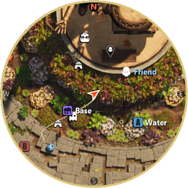
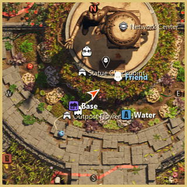
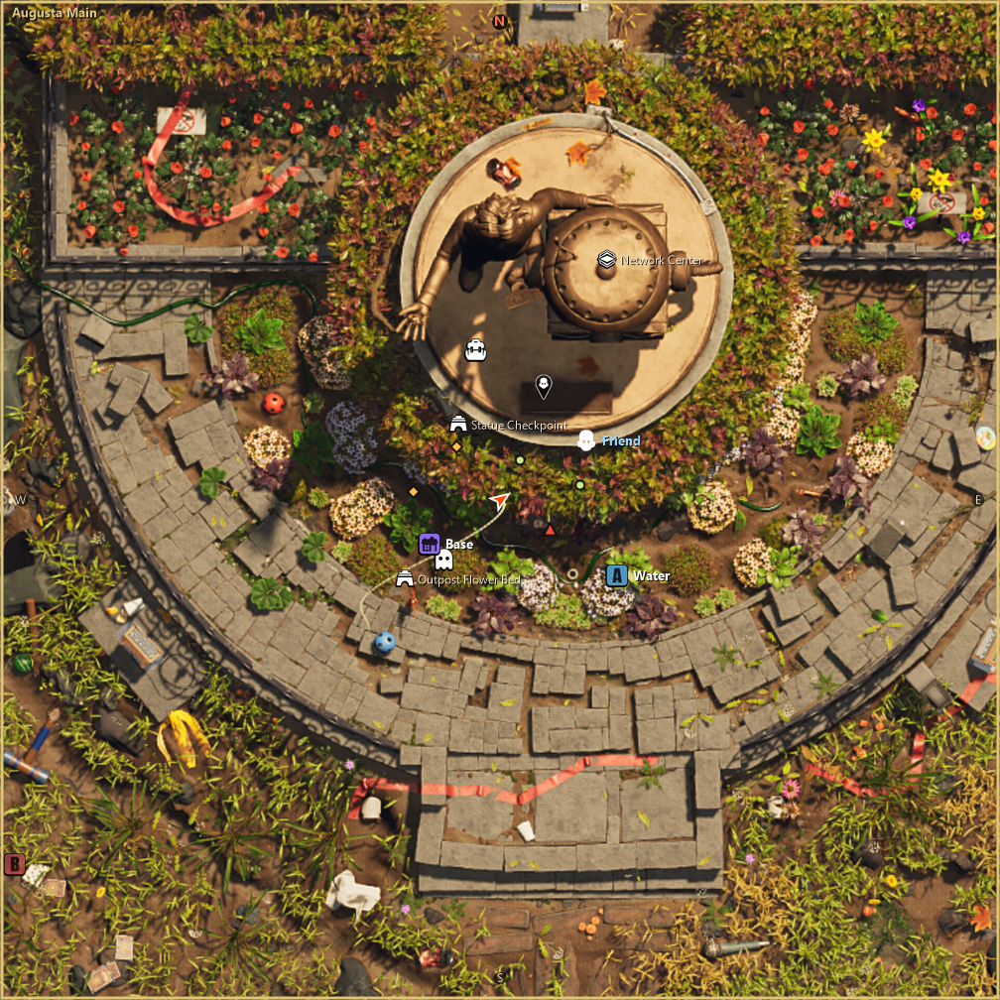
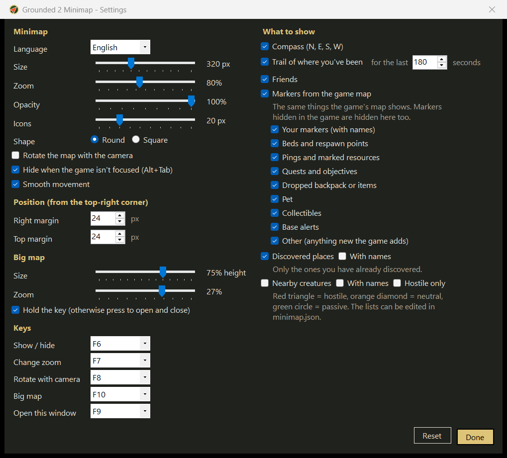
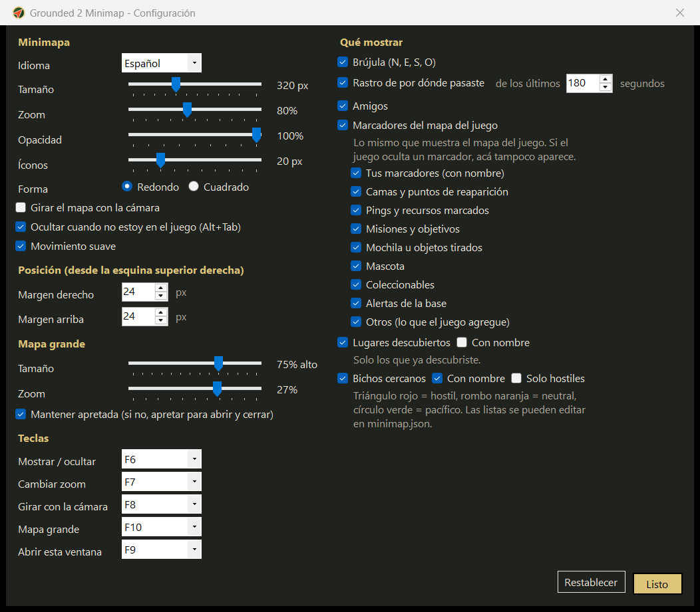

# Grounded 2 Minimap

An overlay minimap for **Grounded 2** (Steam). It sits in the top-right corner of the screen and shows where you are, which way you're facing, your friends, and the same things the in-game map shows: your markers, beds, pings, quests, dropped backpack, pet, collectibles and discovered places, with the game's own icons and colors.

- **Read-only**: it reads the game's memory with `ReadProcessMemory`. It never writes to the game, injects nothing and doesn't modify game files (the `.pak` files are only read).
- **Lightweight**: around 0.1% CPU, and it doesn't touch the game's GPU.
- **Survives updates**: there are no hardcoded offsets or lists. Everything is found by name through Unreal Engine's reflection and read from the game's own data: levels, map bounds, marker types, icons, colors and creatures. New areas, levels, markers or creatures show up on their own.
- **English and Spanish**: follows the Windows language, or pick one in the settings.

| Round | With nearby creatures | Square |
|:---:|:---:|:---:|
|  |  |  |
| Your arrow, trail, friend, base, beds and markers | Hostile ▲ red, neutral ◆ orange, passive ● green | Square, with discovered place names |

## Download

Grab **GroundedMinimap.zip** from the [latest release](../../releases/latest), unzip it anywhere and run `GroundedMinimap.exe`.

You need the **.NET 10 Desktop Runtime**: `winget install Microsoft.DotNet.DesktopRuntime.10` (or [download it](https://dotnet.microsoft.com/download/dotnet/10.0)).

Keep the `extractor` folder next to the exe: it's what pulls the map and icons out of the game files. Without it the minimap still works, but only with the built-in main map and simple icons.

## Usage

1. Set the game to **borderless window**. The overlay can't draw over exclusive fullscreen.
2. Run `GroundedMinimap.exe`, before or after starting the game.
3. An icon appears in the system tray: **right-click** for the menu, **double-click** for the settings.

| Key | Action |
|-----|--------|
| **F6** | Show / hide the minimap |
| **F7** | Next zoom level |
| **F8** | North up, or rotate with the camera |
| **F10** | Big map (hold it, or press to open and close) |
| **F9** | Open the settings |

Keys can be changed in the settings and only work while the game is in the foreground.

**Big map (F10)**: the whole level over the game, with the level name, compass, discovered places with their names, markers and friends.



## Settings

Open them with F9, by double-clicking the tray icon, or with `GroundedMinimap.exe --settings`. Changes apply instantly, and the minimap stays visible as a preview while the window is open.



- **Minimap**: language, size, zoom, opacity, icon size, round or square, rotate with the camera, hide on Alt+Tab, smooth movement, position.
- **Big map**: size (as a % of the game window height), zoom, hold or toggle.
- **What to show**, each one can be turned on or off:
  - Compass (N, E, S, W).
  - A trail of where you've been over the last N seconds.
  - Friends, with the game's player icon and their name. When they're out of view they stay on the edge, pointing the way.
  - Markers from the game map, by group: your markers (with their names and colors), beds and respawn points, pings and marked resources, quests, dropped backpack or items, pet, collectibles, base alerts, and "other" for anything new the game adds. Markers you hid on the game map stay hidden here too.
  - Discovered places, with or without names. Only the ones you've already found.
  - Nearby creatures, with or without names, or hostile only. Red triangle = hostile, orange diamond = neutral, green circle = passive. New creatures count as hostile until you add them to `PassiveCreatures` / `NeutralCreatures`.

Everything is saved to `minimap.json` next to the exe, which you can also edit by hand. It also holds `ZoomLevels` (the steps F7 cycles through), the creature lists, and fallback map bounds (`MinX/MaxX/MinY/MaxY`) that are only used if the game's level data can't be read.

`minimap.log` records the connection to the game, extractions and anything that couldn't be read. If something looks wrong, check it first. It trims itself once it passes 256 KB.

<details>
<summary>Configuración en español</summary>



</details>

## Building

You need the **.NET 10 SDK** (`winget install Microsoft.DotNet.SDK.10`).

```powershell
.\build.ps1
```

This produces `dist\GroundedMinimap.exe` (about 20 MB, it carries the main map for the first run) and `dist\extractor\`.

A `map.png` placed next to the exe replaces the main map.

### Releases

Every push to `main` runs `.github/workflows/release.yml`: it builds on GitHub Actions and publishes a release `v1.0.<run number>` with `GroundedMinimap.zip` (exe + extractor) and the bare `GroundedMinimap.exe`.

## Project layout

```
Grounded2Minimap/
├── build.ps1                 Builds the overlay and the extractor into dist/
├── .github/workflows/        Build + release on every push to main
├── dist/                     Exe, extractor/, minimap.json, minimap.log
│   ├── maps/                 (cache) each level's map, extracted from the .pak files
│   └── icons/                (cache) the game's map icons, extracted from the .pak files
├── map/grounded2_map.png     Main map 4096x4096 (embedded in the exe as a fallback)
├── Overlay/                  The minimap (WinForms, .NET 10)
│   ├── Program.cs            Startup, settings file, log
│   ├── Lang.cs               English / Spanish texts
│   ├── Demo.cs               Sample data for --demo / --demo-big (screenshots without the game)
│   ├── Overlay.cs            Overlay window, drawing, keys, big map, tray icon
│   ├── SettingsForm.cs       Settings window
│   ├── GameReader.cs         Reads the game: player, friends, level, markers, places, creatures
│   ├── MapStore.cs           Map per level (cache + extraction when the .pak files change)
│   ├── IconStore.cs          Game icons (cache + extraction)
│   ├── UE.cs                 Unreal Engine 5 reader (FNamePool, GUObjectArray, reflection)
│   ├── app.ico               App icon
│   └── make_icon.ps1         Generates app.ico
├── Extractor/                Pulls maps and icons out of the game's .pak files (CUE4Parse)
├── Probe/                    Diagnostics: prints offsets and position to the console
└── screenshots/
```

## How it works

### Attaching (`UE.cs`)

1. Opens `Grounded2Steam-Win64-Shipping.exe` with read access only.
2. Scans the exe's data sections for two Unreal globals, without byte signatures:
   - **FNamePool**: the first block starts with `"None"` followed by `"ByteProperty"`.
   - **GUObjectArray**: the `Objects*, PreAlloc*, Max, Num, MaxChunks, NumChunks` pattern. `NumChunks` can be larger than `Num` needs (the engine preallocates chunks), so each candidate is checked against the index of several objects before it's accepted. The item size (24 bytes in Grounded 2) is detected too.
3. Uses the engine's reflection to look up every property offset by name.

### What it reads (`GameReader.cs`)

| Data | Source |
|------|--------|
| Your position (~30/s) | `GameEngine → GameInstance → LocalPlayers[0] → PlayerController → Pawn → RootComponent → RelativeLocation`; uses the camera while attached to something (ziplines) |
| Friends | `World → GameState → PlayerArray → PlayerState.PawnPrivate` |
| Level and map bounds | `SurvivalGameInstance.LevelData`, the entry whose `RelLevel`/`DevLevel` matches the current world: `MinBounds`, `MaxBounds`, `MapTextureSize`, map background widget |
| Markers | Every `Registered*MarkerData` list in `GameState.HUDMarkerManagerComponent`: position, type (the `EHUDMarkerType` enum, read by name), variant, color, name, hidden flag |
| Icons and colors | `GlobalUIData`: `HUDMarkerBrushes` (texture per type and variant), `LegendIconMap`, `PointOfInterestTypeMappings`, `HUDMarkerColorOptions` |
| Discovered places | `PointOfInterestComponent`s in the world, filtered by `SurvivalPlayerState.DiscoveredPointsOfInterest` |
| Creatures | Every actor deriving from `SurvivalCreature`, minus dead ones (`HealthComponent.HealthState`) and pets |

Places and creatures come from a separate thread that walks `GUObjectArray` every 2 seconds; after the first pass it only looks at objects that changed. Each group is optional: if a patch renames something, only that part switches off and the log says so.

### Maps and icons (`MapStore.cs`, `IconStore.cs`, `Extractor/`)

- The `.pak` folder comes from the game's exe path (`<Project>\Binaries\Win64` → `<Project>\Content\Paks`).
- **Map**: the extractor opens the background widget named in `LevelData`, finds the texture it references and decodes it into `dist\maps\<Level>.png`, together with a fingerprint of the `.pak` files (size + date). When a patch changes them, the map is extracted again in the background while the old one stays on screen.
- **Icons**: the extractor gets the list of textures the game's map uses and saves them to `dist\icons\`. They're tinted with the marker's color, like in the game. Icons the game draws with materials (which can't be extracted) use the matching legend icon, or a simple shape.
- There are no public mappings (`.usmap`) for this version, so textures are read from the raw package bytes: the pixel format (`PF_BC7`, etc.) comes from the name table and the single mip sits at the end of the file. The size comes from `LevelData` (map) or from the file size (square icons).

Running the extractor by hand:

```powershell
$paks = "<Steam library>\steamapps\common\Grounded2\Augusta\Content\Paks"
dist\extractor\Extractor.exe map   $paks Augusta /Game/UI/Map/UI_MapBGBackyard 4096 4096 map.png
dist\extractor\Extractor.exe icons $paks Augusta .\icons /Game/UI/Images/MapIcons/T_UI_Flag_Map_Home
```

### Diagnostics

```powershell
cd Probe
dotnet run -c Release
```

Prints the structures it found, the resolved offsets, the local pawn and its position.

## Notes

- Tested with Steam build `Augusta-CL-3235807`.
- Grounded 2 has no anti-cheat. Still, this is an unofficial external tool: use it at your own risk.
